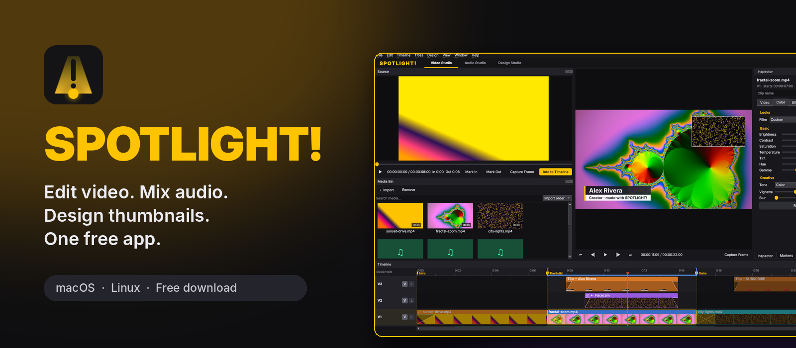
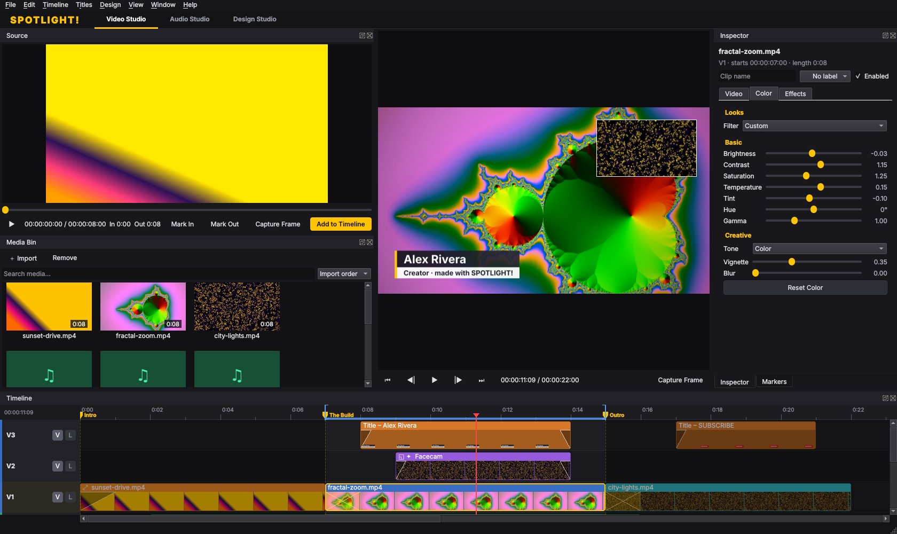
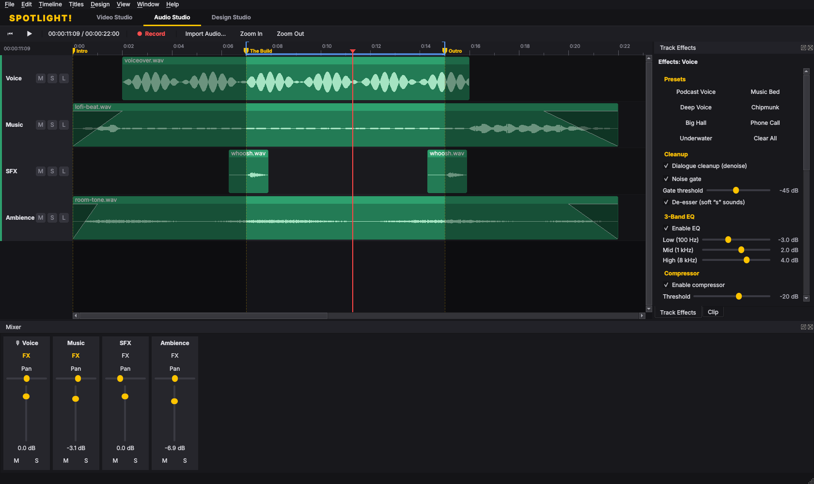
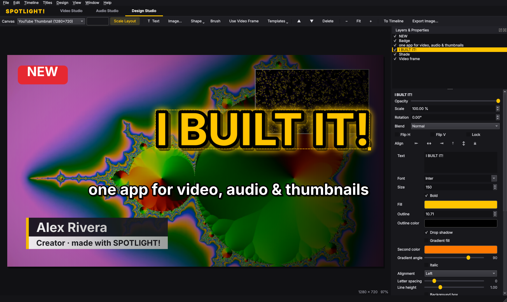

<p align="center">
  
</p>

<p align="center">
  <a href="https://github.com/NyteRyzer/spotlight-/releases/latest"><b>⬇ Download for macOS &amp; Linux</b></a> ·
  <a href="#features">Features</a> ·
  <a href="#keyboard-shortcuts">Shortcuts</a> ·
  <a href="#building">Build from source</a>
</p>

**SPOTLIGHT!** is a free desktop creative studio for YouTubers, podcasters and editors. It brings the everyday
features of **Premiere Pro, CapCut, Filmora, Logic Pro and Photoshop** into one app. You edit a video, clean up and
mix its audio, then design its thumbnail, all in **one project**.

| 🎬 Video Studio | 🎚 Audio Studio | 🎨 Design Studio |
|---|---|---|
|  |  |  |

## Features

### 🎬 Video Studio (Premiere / CapCut / Filmora)
- **Multitrack timeline** with move, trim, split (razor), ripple delete, **insert edits**, **close gaps**,
  snapping, linked audio/video, copy/paste/duplicate and markers.
- **Pro editing keys:** ripple trim to the playhead (`Q`/`W`), jump between edit points (`↑`/`↓`), **In/Out
  points** (`I`/`O`) with **lift** and **extract**, one-frame **nudge**, **match frame** (`F`), **J/K/L shuttle**,
  **loop playback** and **go to timecode** (`Ctrl+G`).
- **Organize clips:** color labels, clip names, enable/disable (`Shift+E`), **replace clip** with bin media and
  **paste attributes** (look, transform, effects, audio) onto many clips at once.
- **Markers panel:** rename, jump and delete markers, and turn them into **YouTube chapters** for your description.
- **Layered compositing.** Upper tracks sit on top of lower ones, so you can do **picture-in-picture**,
  **split screen**, overlays and logos.
- **Transform** any clip: scale, position, rotation, opacity, flip and crop. One-click PIP and split-screen layouts.
- **Transitions:** cross dissolve, dip to black/white, wipes, slides, iris, clock wipe, pixelate and zoom.
- **Titles and lower thirds.** Eight styles: Big Title, Lower Third, Caption, Subscribe Button, Chapter Card, Neon,
  Breaking News and Quote. They stay editable, with a live preview.
- **Captions:** import and export **SRT** subtitles.
- **Speed** from 0.1× to 8× (pitch-preserving audio), **reverse**, and **freeze frame**.
- **Looks / filters:** Warm, Cool, Vivid, Cinematic, Vintage, Faded, Moody, Dreamy, B&W, Noir and Sepia. You can
  also fine-tune brightness, contrast, saturation, temperature, tint, vignette and blur.
- **Chroma key** (green and blue screen), **Ken Burns** zoom and pan, and **stabilization**.
- **Effects:** sharpen, film grain, pixelate (censor), invert, **cinema bars**, hue and gamma, plus **blur fill**
  (the blurred background behind vertical clips) and a **border** for picture-in-picture.
- **Entrance animations:** slide in from the left, right or bottom, and pop in.
- **Auto-Clip for videos and stream VODs:** import a long video and SPOTLIGHT! finds the moments worth clipping
  (big reactions, hype, laughter, fast action) on its own. Review the clips with thumbnails and a preview, then
  add them to the timeline as a highlight reel or export each one, ready for Shorts, TikTok and Reels as vertical
  9:16 or square. Right-click any video in the Media Bin, or press `Ctrl+Shift+H`.
- **Smart tools:** **Remove Silences** (automatic jump cuts), **Scene Edit Detection**, **beat markers**
  (BPM or tap tempo) and **Auto Reframe** to 9:16, 1:1 or 4:5 for Shorts, Reels and TikTok.
- The preview **matches the export**. The Program Monitor composites tracks, looks, keys and transitions the same
  way the renderer does.
- **Export presets:** YouTube 1080p/4K, Shorts/Reels/TikTok, Instagram, H.265 archive, WebM, **animated GIF**,
  podcast MP3 and WAV. Includes loudness normalization to −14 / −16 LUFS. Export the whole timeline or just the
  **In/Out range**.

### 🎚 Audio Studio (Logic Pro)
- Waveform timeline with a **mixer**: volume, pan, mute and solo.
- Per-track effects: **dialogue cleanup** (denoise), **noise gate**, **de-esser**, **3-band EQ**, **compressor**,
  **voice changer** (pitch shift), **telephone/radio**, **chorus**, **high-pass and low-pass filters**, **reverb**,
  **echo/delay**, **mono** and **limiter**.
- **Detect tempo (BPM)** from a music clip and drop bar markers on the beat.
- **Loudness meter:** measures the whole mix (integrated LUFS, range, true peak) against YouTube, podcast and
  broadcast targets.
- **Export stems:** every audio track as its own WAV. **Quick fades** on any selection (`Ctrl+Shift+D`).
- **Auto-ducking:** music dips automatically under voice tracks, and you can see and hear it while editing.
- **Record audio** from any mic or interface (**● Record** in the Audio Studio, or `Ctrl+R`). It has a live
  level meter, a count-in, play-along, and unlimited takes on the track you choose. Takes are saved as lossless WAV.
- One-click presets: Podcast Voice, Music Bed, Deep Voice, Chipmunk, Big Hall, Phone Call and Underwater. Plus clip
  gain, fades and **Normalize**.

### 🎨 Design Studio (Photoshop)
- Layers of images, text, shapes (rectangle, ellipse, triangle, star, arrow, line, **speech bubble**, **burst**)
  and **brush drawings**.
- **Zoom and pan** the canvas, **smart snapping** to edges, centres and other layers, and arrow-key nudging.
- **Blend modes:** Multiply, Screen, Overlay, Soft Light, Difference and more. Layers can be flipped, locked and
  aligned.
- **Layer effects:** drop shadow, outer glow, and **stroke**. The classic white outline around a cut-out subject is
  one slider.
- **Remove background** from solid or studio backdrops. Image adjustments include crop, hue, blur, B&W, invert and
  **fade masks**.
- Text with outline, shadow, **gradient fill**, italic, letter spacing, alignment and caption-style background
  boxes. Shapes can use gradient fills, and photos can get a one-color **tint** (duotone).
- **Eight thumbnail templates** (Reaction, Tutorial, Podcast, Versus, Gaming, Vlog, Before/After, Top 10),
  safe-zone guides (including the YouTube timestamp corner), and canvas presets for thumbnails, channel art,
  posters and stories. **Smart resize** refits your layout when you switch, say, from a thumbnail to a Shorts cover.
- **Grab any video frame** as a layer, and send any design **to the timeline** as an intro or end card.

### 🔗 One connected project
- **Autosave** and crash **recovery**, undo/redo for everything, relinking of moved media, and the last 10 saved
  versions kept in a **Backups** folder next to your project.
- **Command palette** (`Ctrl+K`): type to find and run any command.
- **Media Bin search and sort**, dimmed unused media, **Remove Unused Media**, **Show in Folder**, and
  **Collect Files** to copy a project and all its media into one folder.
- **Customizable layouts** and **keyboard shortcuts**.
- Bundled FFmpeg, so there is nothing else to install.

## Download

Get the latest build from the **[Releases page](https://github.com/NyteRyzer/spotlight-/releases/latest)**:

| Platform | File | Notes |
|---|---|---|
| macOS 14+ (Apple Silicon) | `SPOTLIGHT-<ver>-macOS-arm64.dmg` | Drag to Applications. Not notarized yet: on first launch use **System Settings → Privacy & Security → Open Anyway**. |
| macOS 12+ (Intel) | `SPOTLIGHT-<ver>-macOS-Intel.dmg` | Same as above. |
| Linux x86_64 (2024+ distros) | `SPOTLIGHT-<ver>-x86_64.AppImage` | `chmod +x` and run, nothing to install. |
| Ubuntu 24.04 / Debian 13 | `spotlight-<ver>-linux-x86_64.deb` | `sudo apt install ./spotlight-*.deb` |

## Keyboard shortcuts

| Action | Shortcut | Action | Shortcut |
|---|---|---|---|
| Play / pause | `Space` | Split at playhead | `S` |
| Previous / next frame | `←` / `→` | Ripple delete | `Shift+Del` |
| Overwrite source clip at playhead | `.` | **Insert** source clip at playhead | `,` |
| **Freeze frame** | `Shift+F` | **Record audio** | `Ctrl+R` |
| **Add title** | `Ctrl+Alt+T` | Add / remove marker | `M` |
| **Auto-Clip highlights** | `Ctrl+Shift+H` | Remove silences, scene detection | Timeline menu |
| Next / previous marker | `Shift+M` / `Alt+M` | Snapping | `N` |
| Copy / paste / duplicate | `Ctrl+C` / `V` / `D` | Zoom in / out / fit | `=` / `-` / `\` |
| Import media | `Ctrl+I` | Export video/audio | `Ctrl+M` |
| Export frame as image | `Ctrl+Shift+E` | Place design on timeline | `Ctrl+Shift+T` |
| Capture program frame to design | `Ctrl+Shift+F` | Show guides | `G` |
| Video / Audio / Design studio | `Ctrl+1` / `2` / `3` | Add text layer | `Ctrl+T` |
| **Command palette** | `Ctrl+K` | Go to timecode | `Ctrl+G` |
| Ripple trim start / end to playhead | `Q` / `W` | Previous / next edit point | `↑` / `↓` |
| Mark In / Out / clip | `I` / `O` / `X` | Lift / extract In–Out | `;` / `'` |
| Shuttle back / stop / forward | `J` / `K` / `L` | Loop playback | `Ctrl+L` |
| Nudge clips one frame | `Alt+←` / `Alt+→` | Match frame | `F` |
| Enable / disable clip | `Shift+E` | Quick fade in/out | `Ctrl+Shift+D` |
| Copy / paste attributes | `Ctrl+Alt+C` / `Ctrl+Alt+V` | Clear In/Out | `Ctrl+Shift+X` |

(`Ctrl` is `⌘` on macOS. Every shortcut can be changed in **Edit → Keyboard Shortcuts**.)

## Building

Requirements: CMake ≥ 3.21, a C++17 compiler, **Qt ≥ 6.4** (Core, Gui, Widgets, Multimedia), and
**FFmpeg** (the `ffmpeg` command, used for export and waveforms).

### macOS
```bash
brew install qt ffmpeg cmake ninja
cmake -S . -B build -G Ninja -DCMAKE_BUILD_TYPE=Release -DCMAKE_PREFIX_PATH="$(brew --prefix qt)"
cmake --build build
open build/src/app/SPOTLIGHT.app
```
Installer: `packaging/macos/build-dmg.sh` → `build-macos/SPOTLIGHT-<ver>-macOS-arm64.dmg`,
a self-contained app with Qt, ffmpeg and ffprobe bundled and an ad-hoc signature.

Intel Mac installer (runs on macOS 12+): install Qt 6.8 from qt.io (or `pip install aqtinstall && aqt install-qt mac desktop 6.8.3 clang_64 -m qtmultimedia`),
fetch static FFmpeg with `packaging/macos/fetch-ffmpeg.sh ~/ffmpeg-static x86_64`, then
`QT_PREFIX=~/Qt/6.8.3/macos FFMPEG_BIN=~/ffmpeg-static DEPLOY_TARGET=12.0 DMG_LABEL=Intel packaging/macos/build-dmg.sh`.

### Linux (Ubuntu 24.04 / Debian 13)
```bash
sudo apt install cmake ninja-build g++ ffmpeg qt6-base-dev qt6-base-dev-tools qt6-multimedia-dev qt6-qpa-plugins
cmake -S . -B build -G Ninja -DCMAKE_BUILD_TYPE=Release
cmake --build build
./build/src/app/spotlight
```
Installers: `cd build && cpack` → `.deb` and `.tar.gz`; `packaging/linux/build-appimage.sh` → portable `.AppImage`
(bundles Qt, ffmpeg and ffprobe). Fedora: `sudo dnf install qt6-qtbase-devel qt6-qtmultimedia-devel ffmpeg cmake gcc-c++`.

### Tests
```bash
QT_QPA_PLATFORM=offscreen ctest --test-dir build --output-on-failure
```
Unit tests cover timeline editing (including speed, insert, ripple and freeze frame), project files, undo,
autosave/recovery, captions and the export graph. Render tests export real files with FFmpeg and check the output
pixels: transitions, picture-in-picture and chroma key. GUI tests check that the preview compositor matches, render
design effects, and drive the whole window offscreen.

CI (`.github/workflows/build.yml`) builds, tests, packages and smoke-launches the installers on Ubuntu 24.04 and
macOS (Apple Silicon and Intel). Pushing a `v*` tag (or running the workflow with a release tag) publishes the `.dmg`,
`.AppImage`, `.deb` and `.tar.gz` on a GitHub Release.

## Project layout

```
src/core    document model, timeline operations, undo, autosave, export (FFmpeg command builder),
            design renderer, shortcuts — no widgets, fully unit tested
src/media   Qt Multimedia playback: media probing, video view, timeline player, waveforms
src/ui      the three studios, dialogs, main window
src/app     main()
tests/      QtTest suites
packaging/  macOS Info.plist + icon script, Linux .desktop/MIME + AppImage script
docs/       ARCHITECTURE.md, ROADMAP.md
```

See [docs/ARCHITECTURE.md](docs/ARCHITECTURE.md) for how it fits together and
[docs/ROADMAP.md](docs/ROADMAP.md) for what comes next.
